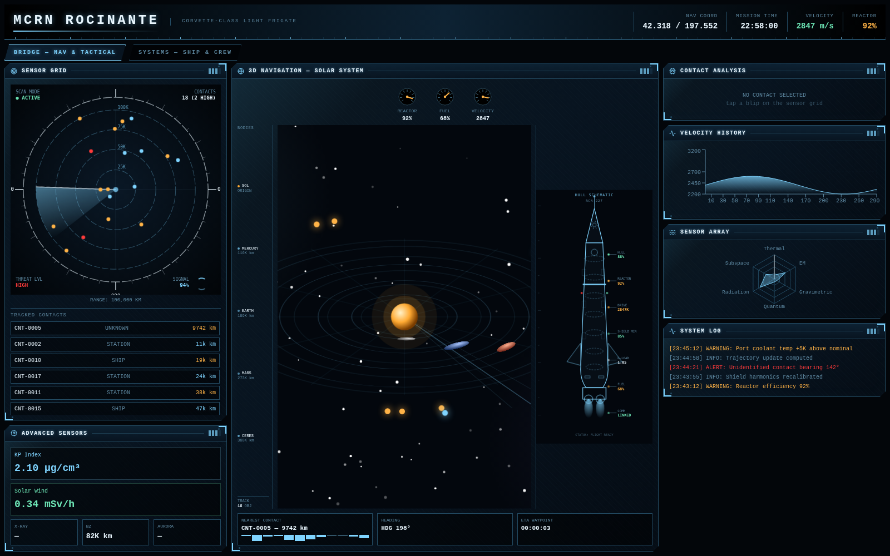

# Rocinante Explorer

*Prototype preview; ship systems are simulated.*

A command-deck interface can make space information more inviting to explore than a collection of unrelated numbers. Rocinante Explorer is a browser prototype that combines a fictional spacecraft dashboard with satellite, launch, crew and space-weather context when the connected feeds are available. It is an interactive visual experience, with a clear distinction between external observations and simulated ship systems.

## Tech stack

| Layer | Technologies |
|---|---|
| Interface | React; JavaScript; HTML; CSS |
| Charts and visuals | Recharts; SVG; Lucide |
| Orbital context | satellite.js |
| Project tooling | Vite; Tailwind CSS |

## Explore the bridge

The Bridge view brings a sensor grid, contact list and solar-system navigation display together. Selecting a contact opens its available details, making it easier to move from the overall display to a single object. Velocity charts and navigation readouts add context to the moving presentation.

The bridge offers an immediate way into the Explorer's ship-focused setting. Begin with the broader deck, then inspect the panels that explain a selected part of the experience.

## Bring space observations into the deck

When its supporting feeds are available, the prototype can show satellite observations, an ISS-based navigation position, a crew roster, space-weather information, upcoming launches and near-Earth-object context. These areas offer real-world material to explore within the fictional setting. Their availability depends on the connected feeds; animated displays alone do not establish that fresh observations have arrived.

Source-backed space observations add a real-world point of reference beside the ship presentation. Keep their origin in mind when moving between those observations and fictional vessel information.

## Inspect fictional ship systems

The Systems view groups propulsion, life support, weapons, shield condition and crew-vital displays. An integrity map, spectrum-style animation and sensor charts give the interface a consistent command-deck character. These ship readings and fictional contacts are simulated and are intended for exploration and entertainment.

The system views invite a closer look at the imagined vessel. They extend the experience beyond the main bridge while keeping the same visual and navigational context.

## Follow the changing context

The operations feed can present available space-weather and launch information, while a simulated system log supports the fictional experience when that context is absent. This lets the prototype remain explorable without presenting every animated number as a real measurement.

Changing context gives the workspace something to revisit rather than a single static scene. Follow the available information through the deck while preserving the distinction between source observations and simulation.

## Understand this edition

This edition is an exploratory prototype, separate from [Rocinante Command Center](https://github.com/logicencoder/roci-command-center-overview), which has its own presentation. It demonstrates a particular visual and interaction direction; it is not a spacecraft control system or a claim of continuously verified live telemetry.

This edition has its own scope and should be understood through the capabilities described here. Related Rocinante projects may offer a different workspace rather than the same product under another name.

---

Private implementation: [roci](https://github.com/logicencoder/roci)

See [REPOS.md](REPOS.md) for related project links.

**[Logic Encoder](https://logicencoder.com)** · [GitHub](https://github.com/logicencoder) · [Contact](https://logicencoder.com/contact/)
